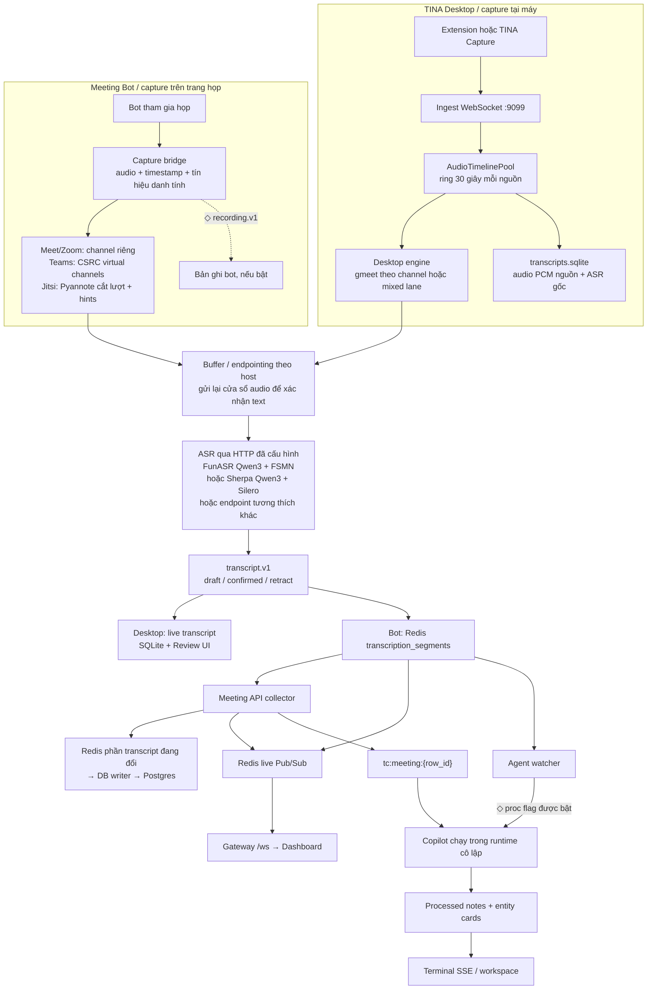
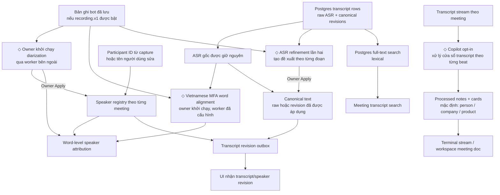

# Pipeline cuộc họp hiện tại của TINA

Sơ đồ ánh xạ implementation có trong checkout hiện tại. Nó mô tả các đường local Desktop và meeting bot riêng nhau, cùng các bước hậu kỳ tùy chọn.

`◇` là nhánh tùy cấu hình hoặc cần người dùng khởi chạy. Sơ đồ theo source code; chưa xác nhận dịch vụ nào đang chạy trong một deployment cụ thể.

## Capture đến transcript

Desktop có ring buffer 30 giây cho mỗi nguồn và lưu audio PCM cùng transcript gốc vào SQLite. Bot cloud có thể lưu bản ghi riêng nếu bật recording.

Các backend Qwen3 + FSMN-VAD và Qwen3 + Silero-VAD đều có trong source. Chúng nhận các cửa sổ audio qua HTTP, không stream token; TINA tạo draft và final bằng cách gửi lại cửa sổ rồi xác nhận phần text ổn định.

## Speaker, hậu kỳ và meeting memory

Diarization và alignment là job hậu kỳ trên audio bot đã lưu; refinement cũng tạo đề xuất để người dùng duyệt. Các thay đổi transcript và speaker có revision/outbox. Speaker registry gắn danh tính trong phạm vi từng meeting.

Copilot là nhánh riêng, chỉ được arm khi bật xử lý cho meeting. Cấu hình mặc định tạo notes và entity cards cho person/company/product; chưa mặc định trích xuất actions, decisions hoặc facts. Tìm transcript hiện dùng Postgres full-text search; source chưa nối `pgvector` hoặc hybrid vector + lexical retrieval.

Desktop local có Review UI và job ASR refinement lần hai. README của Desktop ghi rõ nhánh này chưa thêm word alignment hoặc diarization.

## Implementation pointers

- Audio ring và source timeline: `core/meetings/modules/buffer/src/audio-ring.ts`
- Desktop capture, SQLite archive và Review: `core/meetings/services/desktop/README.md`
- FunASR Qwen3 + FSMN-VAD: `deploy/transcription/funasr/README.md`
- Sherpa Qwen3 + Silero-VAD: `core/meetings/services/native-asr/README.md`
- Bot lane routing: `core/meetings/services/bot/src/pipeline.ts`
- Speaker registry, diarization, alignment, refinement: `core/meetings/services/meeting-api/src/meeting_api/collector/`
- Copilot defaults: `core/agent/workspace-seeds/default/agents/meeting.md`
- Transcript search contract: `core/meetings/services/meeting-api/src/meeting_api/collector/ports.py`
