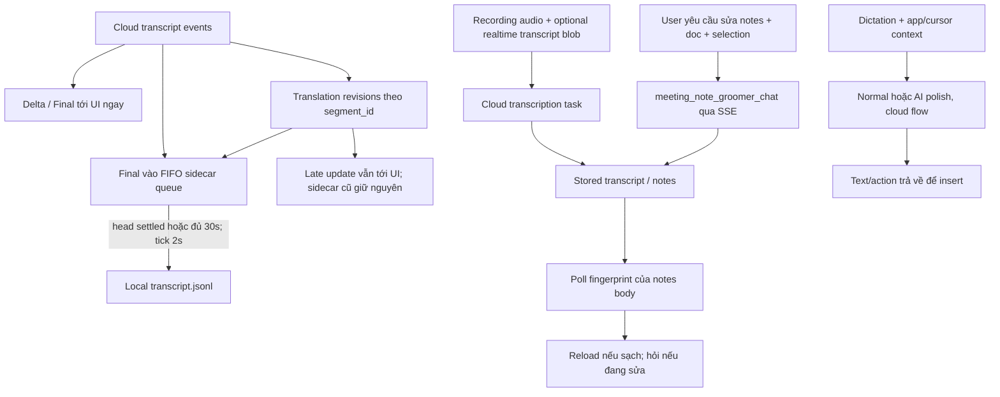

# Speakly postprocess: đối chiếu report và phương án cho TINA

Ngày kiểm tra: 2026-10-28. Đối tượng: Genspark Speakly **1.6.5200**, bundle `1.6.5200.5200`,
`ai.mainfunc.genspark.voice.beta`, tại `/Applications/Genspark Speakly.app`.
Tài liệu đối chiếu: `/Users/jky/orca/pre-TINA/genspark-speakly-pipeline.md`, chủ yếu mục 4.

**Kết luận:** report có nhiều thành phần đúng, nhưng mô tả quá mạnh và ghép các nhánh khác nhau
thành một chuỗi. Có thể học cách phân lớp, hiển thị bản dịch và xử lý notes bị cũ; không nên sao
chép nguyên pipeline hay coi queue 30 giây là cơ chế chống cắt từ hoặc LLM sửa ASR.

## 1. Bằng chứng và giới hạn

- ASAR SHA-256: `fa341adaa9dfc5102d3bc3a950c06034a7c353548f6d833434d403011009e885`.
- REA phân tích trực tiếp ASAR bị chặn bởi integrity mismatch của một thư viện **unpacked**:
  `node_modules/sherpa-onnx-darwin-arm64/libonnxruntime.dylib`. Declared hash bắt đầu `a02e26ab…`,
  bytes hiện tại bắt đầu `9f7b7e43…`. Không suy ra nguyên nhân của mismatch, không phân tích lại
  native AEC, và không coi toàn bộ bundle đã vượt kiểm tra integrity.
- Đã trích xuất 658 first-party JS/JSON từ ASAR để tìm kiếm, kiểm tra SHA-256 từng file theo
  integrity metadata; không sửa ứng dụng. Sau đó REA phân tích hai snapshot giới hạn riêng.
- **S1** — `ev_b5ed93385fe361bb285614768780e53d6f62c67bd2e1aab697da63b131cf95fe`:
  15 JS + package manifest, 0 parse failures, không bị cắt graph trong phạm vi này.
- **S2** — `ev_d74a84995f0c4b8dc57045c8c7a308ee410c63778ba155a4bb2733fc2d57bd9b`:
  NotesService, RecordingUploader, TranscriptionManager + manifest; 0 parse failures.
- Cả hai là `shipped-artifact / derived`, không phải quan sát app đang xử lý audio. Semantic
  coverage còn partial/unknown: lần lượt 12.225 và 1.575 unknown records. Dependency ngoài phạm
  vi, native implementation và cloud server không được phục hồi.
- **C1** — `ev_575b0fe0137ea21091218b785521547d09c8c871f11cd769cc5bf77ed7494819`:
  REA controlled replay chạy các module đã trích xuất với clock, logger, storage và dependency
  giả lập. Probe exit 0; 11 nhóm kiểm tra đúng. Đây không phải live meeting, đo latency hay WER.
  Một lần probe trước đó thiếu stub đã thất bại và vẫn được giữ trong full evidence bundle;
  chỉ C1 là kết quả thành công được dùng ở đây.
- Không gửi audio tới Speakly, không dùng tài khoản/backend riêng của người dùng. Không xác nhận
  cloud dùng model nào, prompt nào, chất lượng tiếng Việt hoặc thời gian phản hồi thực.

[Evidence summary + source hashes](artifacts/speakly-postprocess-20261028/evidence-summary.json)
và [probe có thể đọc lại](artifacts/speakly-postprocess-20261028/probe.cjs).
Full REA bundle ở `/tmp/tina-speakly-postprocess-20261028/rea-evidence-bundle-final.json`
(155.488.288 bytes); đường dẫn và SHA-256 của bundle được lưu trong summary. Summary là bản rút gọn
do analyst tạo, không thay thế canonical REA Evidence. Source snapshot ở cùng thư mục `/tmp` có thể
bị hệ điều hành dọn; source hashes giúp đối chiếu lại đúng phiên bản.

## 2. Đối chiếu từng nhận định

| Nhận định trong report | Bản 1.6.5200 cho thấy | Kết luận |
|---|---|---|
| Mọi text đi qua sanitize → ITN → punctuation → hallucination → settle → groomer | Cloud meeting transcript, local STT, dictation và notes có producer/consumer riêng. | Không có bằng chứng cho một chuỗi chung như sơ đồ. |
| `_cleanText` xóa mọi token kỹ thuật như `<s>`, `</s>` | Chỉ khi engine là `qwen3Asr`, cắt phần đứng trước và gồm marker `<asr_text>`. `<s>hello</s>` vẫn nguyên trong C1. | Đúng một phần, không phải bộ sanitizer tổng quát. |
| `useInverseTextNormalization: 1` áp dụng chung | Flag nằm trong config **SenseVoice**; nhánh Qwen3-ASR không có flag này. | Sai phạm vi. Không đủ bằng chứng cho ITN cloud hay ví dụ số/ngày/tiền Việt. |
| Có model punctuation nhẹ hậu xử lý mọi ASR | Không tìm được bước chung như vậy trong first-party code đã tìm kiếm. UI còn mô tả Dolphin/Paraformer không có punctuation. | Chưa xác nhận; punctuation của backend/model khác vẫn có thể tồn tại. |
| Client phát hiện lặp/ồn và gán `Hallucination`, loại khỏi mọi transcript/notes | `transcriptText.js` chỉ bỏ segment đã có `speaker == 'Hallucination'` hoặc text trống khi export TXT/SRT. | Export filter đã xác nhận; detector và loại khỏi notes chưa được chứng minh. |
| `transcript_update` sửa câu ASR trước dựa trên ngữ cảnh mới | Handler lấy `segment_id`, `translation`, `is_final`; không dùng `data.text`. UI cũng có `applyTranscriptTranslation`. | Bản này là cập nhật **translation**, không phải ASR text correction. |
| Queue 30s chờ hoàn thiện câu rồi mới final/Polish | Final được emit ngay. Queue chỉ trì hoãn **local sidecar write**, có thể flush sớm khi translation terminal tới. | Hằng số đúng; ý nghĩa trong report sai. |
| Flush 2s, ghi một lần vào SQLite/File, bảo đảm đồng nhất | Transcript sidecar là append-only `.transcript.jsonl`; SQLite chứa session metadata. Late update không sửa JSONL đã flush; replay sau flush có thể ghi trùng. | Không phải đảm bảo exactly-once toàn phiên hay transactional canonical store. |
| Alias theo `__index__N` → global alias → raw label | Đúng ở TXT/SRT. | Đây là ưu tiên tên hiển thị, không chứng minh danh tính người nói đúng 100%. |
| `meeting_note_groomer_chat` tạo mọi summary từ toàn settled timeline | Body chứa question, history, current document, selection, meeting_id. Summary generation có API riêng. | Đã ghép chat chỉnh notes với pipeline tạo summary. |
| NotesFreshness tự đồng bộ vì có phát biểu mới | Poll fingerprint của **stored notes body** mỗi 30s ±5s. Editor sạch được reload; editor dirty hiện lựa chọn giữ mình/tải bản mới. | Client kiểm tra notes bị cũ; không chứng minh tự chạy lại summary khi transcript đổi. |
| Context-aware dictation luôn bỏ filler | Có capture before/after/selected text và app context. Nhưng có Normal mode và AI polish; local-only STT là nhánh khác. | Cơ chế context đúng, không nên khẳng định mọi mode đều groom giống nhau. |

## 3. Luồng xác nhận được từ mã

Mũi tên tới cloud task/notes chỉ thể hiện request/response mà client triển khai; không phục hồi
được thuật toán phía server. Sơ đồ không khẳng định mọi cuộc họp đều bật translation hay groomer.

### Live transcript và queue

`dist/src/services/flow/transcript/TranscriptionSessionFlow.js`:

- `:25–33`: settle 30.000ms, tick 2.000ms; comment nói chờ final translation.
- `:502–513`: `transcript_update`/`translation` chuyển vào handler translation.
- `:601–626`: final enqueue và emit `Final` ngay; không chờ 30 giây để hiển thị final.
- `:643–663`: thay `row.translation`; terminal update gọi flush; sau khi flush, sidecar giữ nguyên.
- `:665–685`: final trùng ID chỉ được merge khi row còn nằm trong queue.
- `:693–709`: FIFO head chặn các row trẻ hơn; tuổi queue tính từ enqueue theo wall-clock, không
  phải thời lượng audio. Teardown force flush tại `:261`.

C1 xác nhận final emit trước disk write, terminal translation flush sớm, update không thay ASR text,
head-of-line blocking, late translation không sửa row đã ghi và duplicate final sau flush có thể append lại.
Do đó queue này **không thể bảo đảm ASR không cắt cụt từ**: nó chạy sau kết quả ASR và không đổi audio window.

`dist/src/services/Meeting/RecordingStorage.js:986–1005,1235–1279`:
sidecar là local recovery copy JSONL, append bằng `fs.appendFileSync`. Metadata SQLite là đường khác.
Append lỗi được log/catch; caller vẫn bỏ row khỏi queue sau call. Không thấy retry/ACK cho sidecar
trong đường này. Có khả năng mất local tail khi process crash trước flush hoặc ghi lỗi; không suy ra
cloud cũng mất dữ liệu vì cloud nhận transcript qua kết nối riêng.

### Text và export

- `dist/src/worker/localSttWorkerCore.js:65–75,158–166`: SenseVoice ITN và Qwen marker cleanup.
- `dist/src/utils/transcriptText.js:70–92,119–166`: alias priority, bỏ blank/Hallucination ở vòng export,
  giữ index gốc; TXT half-up và SRT mili giây. Export filter không phải thuật toán phát hiện hallucination.
- Tìm kiếm first-party `dist/src` cho punctuation không tìm thấy universal restoration stage;
  `dist/src/locales/en/common.json:606–610` còn mô tả một số local model không có dấu câu.
  Chuỗi UI là mô tả sản phẩm, không phải benchmark hay bằng chứng model đang được chọn.

### Groomer, summary và freshness là các trách nhiệm khác nhau

- `dist/src/services/Meeting/buildGroomerAskBody.js:5–49`: đóng gói câu hỏi/history/current doc/selection
  với meeting_id, không đính toàn bộ settled transcript hay prompt Executive Summary/Action Items.
- `dist/src/services/Meeting/MeetingChatService.js:1–5,344`: bridge tới cloud agent qua `/api/agent/ask_proxy` SSE.
- `dist/src/services/Meeting/RecordingUploader.js:171–196`: task request có audio URL và optional
  `realtime_transcript_file`. Không phải chỉ chuyển transcript qua một client groomer.
- `dist/src/services/Meeting/NotesService.js:969–1034`: `/api/transcription/{id}/regenerate_summary`
  và `/api/meeting-transcription/generate-summary-from-transcript` là hai API riêng.
- `dist/src/renderer/components/meetingnotes/NoteDetail.js:1732–1795`: gọi các API đó rồi poll notes
  2,5s, timeout 120s; khác với chat groomer SSE.
- `dist/src/services/Meeting/NotesFreshnessService.js:20–21,122–167`: poll fingerprint của notes body,
  bỏ response lệch generation/task, trì hoãn khi busy, dedupe notification.
- `dist/src/renderer/components/meetingnotes/NoteDetail.js:1286–1396`: không reload đè keystroke mới;
  dirty editor hiện Keep mine / Load latest. Đây là cơ chế đáng học cho TINA.

### Dictation context

`VoiceRecognitionService.js:805–854,936–983` capture context và gửi formatLevel theo Normal/AI polish,
kèm dictionary/recent context khi được bật. `ContextService.js:228–238` ánh xạ before/after/selected text.
`contextFormatter.js` chủ yếu format debug display, không phải bản thân groomer.
`VoiceRecognitionService.js:790–800,1030–1061` còn có local-only path không mở cloud STT flow.
Không thấy prompt cloud nên không xác nhận chính xác các quy tắc viết lại của server.

## 4. TINA đã có gì và không nên xây lại

Đây là code audit TINA hiện tại, không phải xác nhận inference production thành công.

| Phạm vi TINA | Có sẵn trong source | Hệ quả |
|---|---|---|
| Desktop durability | `desktop/src/transcript-journal.ts:45,106–129`: SQLite WAL/FULL và transaction save ngay. | Giữ cơ chế này, không thêm RAM-only delay 30s. |
| Bot / Meeting API tail | `collector/db_writer.py:11–20`: mutable tail Redis, mặc định chung 30s, tick10s, Postgres upsert, chỉ trim sau ACK write. Teams CSRC confirmed có override mặc định0. | TINA đã có settle theo nghĩa riêng; không được nói hoàn toàn chưa có. Redis durability còn phụ thuộc deployment. |
| Canonical correction | `desktop/src/refinement.ts:19–28,63–93` + `transcript-journal.ts:601–620`: second-pass ASR proposal, expected_revision/audio hash. | Refinement này không phải LLM polish; vẫn giữ Apply và raw ASR. |
| Live readable notes | `core/agent/worker/meeting.py:241–272,585–604`: CompletionPort trực tiếp, baseline note và policy 3 passes mỗi entry trong processing window, trigger theo speaker/cadence. Re-ingest sau eviction có thể reset counter. | Không thêm một live groomer song song. Policy 3 passes không phải bằng chứng chất lượng tăng hay giới hạn toàn phiên. |
| Processed-view storage | `collector/adapters.py:211–224`: merge notes theo ID. | Chưa thấy guard theo canonical revision ở seam này. |
| Evidence memory | `collector/memory.py:82–116`: evidence có segment_id/revision/time/speaker/quote; source fingerprint. | Tái dùng snapshot/evidence này cho AI notes. Extractor hiện là rules VI/EN, không đồng nghĩa LLM extraction. |
| Dictation | `desktop-native/ui/app.js:976–1018`, `ui/dictation.js:2–12`: raw + optional polish + fallback đã có. | Cursor context là tính năng riêng; `main.rs:347–357` hiện chỉ gửi text ở seam polish đã đọc. |

Các path `desktop/src` là dưới `core/meetings/services/desktop/src`; `collector` là dưới
`core/meetings/services/meeting-api/src/meeting_api/collector`.

Khoảng trống đáng ưu tiên: `worker/meeting.py:539` vẫn tiêu thụ raw transcription stream;
output notes ở `:177–187` không mang canonical source revision/hash. Canonical revision events đi
qua outbox/PubSub (`collector/transcript_revisions.py:24–32`), nhưng trong các producer/consumer
đã kiểm tra chưa thấy đường invalidate/rebuild processed notes tương ứng. UI fingerprint của Speakly
không thay thế được guard này ở server TINA.

## 5. Khuyến nghị triển khai cho TINA

1. **Ưu tiên P1: freshness cho AI processed notes.** Chụp canonical window + speaker mapping hash
   trước gọi CompletionPort. Output mang source revisions/hash, model, prompt version. Chỉ publish
   nếu snapshot còn khớp; edit/restore/rename làm cửa sổ liên quan stale và lên lịch lại. Test bắt buộc:
   delayed LLM response sau user edit, restore và speaker rename không ghi lại nội dung cũ.
2. **P2: một readable layer rõ ràng.** Tái dùng CompletionPort hiện có cho dấu câu, sửa trình bày,
   glossary có căn cứ. Raw/canonical/readable tách biệt. Thay đổi canonical vẫn là proposal + diff +
   Apply/CAS; không tự suy đoán tên, số tiền, ngày, phủ định hoặc từ mất do overlap.
3. **P3: summary/actions từ canonical snapshot có evidence.** Tái dùng Meeting Memory và outbox.
   Mỗi action/decision dẫn segment/revision/quote/time; notes giữ phiên bản người sửa, hiển thị stale
   rồi cho chọn giữ mình hoặc tải bản mới. Không coi fingerprint notes-body là transcript-source hash.
4. **Dictation cursor context: lựa chọn riêng sau đó.** Chỉ đọc before/after/selection khi user opt-in;
   không tự đưa dữ liệu từ ứng dụng khác vào meeting ASR/memory.

Không sao chép: trì hoãn durable write Desktop 30s, hard-delete hallucination dựa trên câu/ngắn,
ITN làm thay số liệu raw, đồng nhất system mix với một người, hoặc đổi backend ASR chỉ vì Speakly
có các thành phần này. TINA đã từng có bằng chứng phrase filter suppress lời nói thật
(`mixed-pipeline/src/hallucination-gate.ts:12–17,78–117`); ưu tiên flag/quarantine có audio evidence.

Đây là đề xuất sau review; chưa triển khai thay đổi hành vi TINA hay sửa tài liệu gốc. Chưa có bằng
chứng việc áp dụng các đề xuất sẽ cải thiện WER/CER/latency; cần integration test revision safety
và đánh giá chất lượng riêng khi người dùng yêu cầu triển khai.
