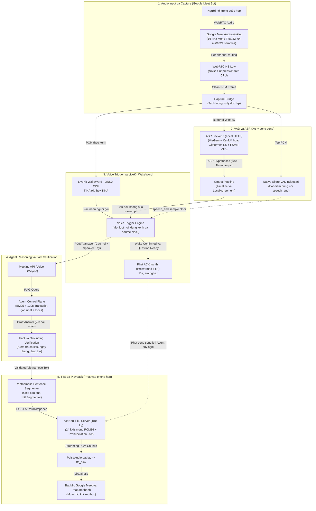
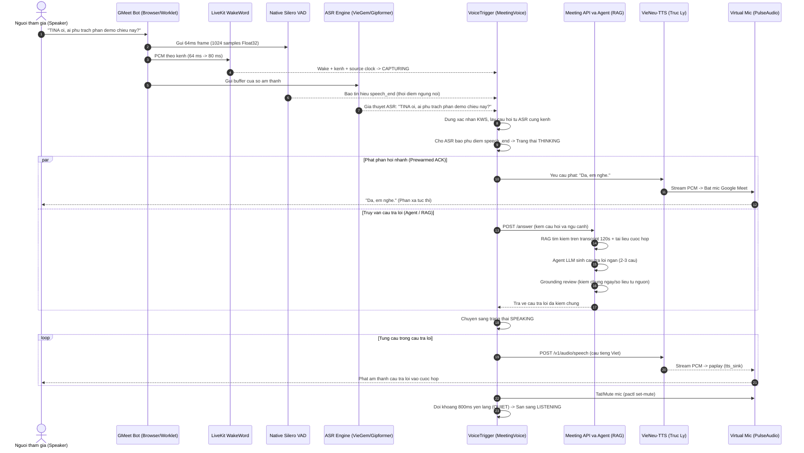
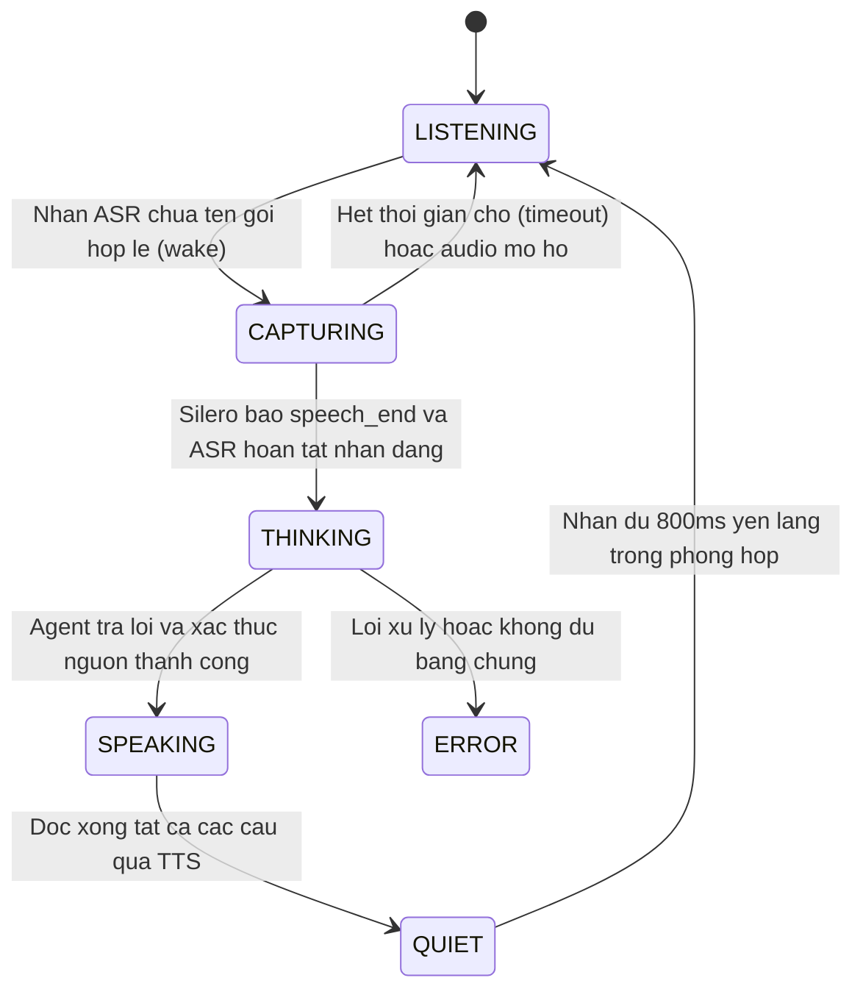

# Kien truc va luong hoat dong he thong giong noi TINA

Tai lieu mo ta chi tiet cach hoat dong cua he thong giong noi trong TINA tu luc thu am thanh cuoc hop (Google Meet), loc tap am, xu ly VAD (Voice Activity Detection), nhan dang tieng noi (ASR), nhan dien tu khoa goi (LiveKit WakeWord), truy van cau tra loi (Agent/RAG), cho den tong hop giong noi (TTS) va phat lai vao micro ao.

---

## 1. So do luong tong quan (Pipeline Architecture)

---

## 2. So do trinh tu mot luot thoai (Turn Sequence Diagram)

---

## 3. Bo may trang thai luot thoai (Turn State Machine)

---

## 4. Chi tiet cac thanh phan ky thuat

### 4.1. Thu nhan va Tien xu ly am thanh (Audio Input & Noise Suppression)
- **Co che thu am**: [pcm-capture.ts](file:///Users/jky/orca/pre-TINA/TINA/core/meetings/modules/gmeet-capture/src/pcm-capture.ts) chay trong trang Google Meet thong qua AudioWorklet, trich xuat am thanh do tre thap o dinh dang **16 kHz Mono Float32** voi kich thuoc khung **64 ms (1024 samples)**.
- **Dinh tuyen theo kenh (Channel-routed)**: Moi nguoi noi trong Google Meet duoc tach biet tren tung kenh doc lap (`ch-<n>`), gan nhan danh tinh bang vien sang avatar (glow name) tai thoi diem bat dau noi theo [gmeet-pipeline.ts](file:///Users/jky/orca/pre-TINA/TINA/core/meetings/modules/gmeet-pipeline/src/gmeet-pipeline.ts).
- **Khu on WebRTC NS Low**: Duoc cai dat tai [noise-suppression.ts](file:///Users/jky/orca/pre-TINA/TINA/core/meetings/services/bot/src/noise-suppression.ts), chay tren CPU qua thu vien native `webrtc-audio-processing` 0.3.1. Su dung hang doi FIFO 160 mau, bu tre thuat toan 96 mau (6 ms) de lam sach am thanh truoc khi dua vao VAD va ASR.

### 4.2. VAD va Nhan dang giong noi (Silero VAD & Local ASR)
- **Silero VAD cuc bo**: [meeting-voice.ts](file:///Users/jky/orca/pre-TINA/TINA/core/meetings/services/bot/src/meeting-voice.ts) khoi tao process con Python chay Silero VAD (~644 KB) o che do `--vad-only` tren CPU. Silero theo doi tung kenh de bat chinh xac mau am thanh ket thuc tieng noi (`speech_end`), loai bo khoang lang thua o cuoi cau.
- **ASR Engine tu host**:
  - Mo hinh: **VieGem CTC + KenLM + FSMN-VAD** ([engine.py (VieGem)](file:///Users/jky/orca/pre-TINA/TINA/deploy/transcription/viegem/engine.py)) hoac **Gipformer 1.5 + FSMN-VAD**.
  - Toi uu tu khoa: KenLM duoc cau hinh name bias uu tien nhan dien tu `"tina"`.
  - [transcription-client.ts](file:///Users/jky/orca/pre-TINA/TINA/core/meetings/modules/whisper/src/transcription-client.ts) gui cac cua so am thanh dinh ky (chu ky 2 giay hoac khi co su kien ngat cau tu VAD) qua HTTP cuc bo.

### 4.3. Co che Wakeword: ASR-Addressed Voice Assistant
Trong bot Google Meet cua TINA, khong can chay them mo hinh KWS (Keyword Spotting) rieng biet, giup toi uu CPU. Thay vao do, he thong su dung co che **ASR-Addressed** tai [voice-trigger.ts](file:///Users/jky/orca/pre-TINA/TINA/core/meetings/services/bot/src/voice-trigger.ts):
- **Cac bien the ten duoc nhan dien o dau cau** (khong phan biet hoa thuong, chuan hoa Unicode NFKC):
  - `TINA`, `Tina`, `TINA oi`, `tin oi`, `ti na oi`, `tien na oi`, `tinh anh oi`, `tin anh oi`.
  - Luu y: Tu choi cac tien to chao tieng Anh (`Hey TINA`, `Hi TINA`) hoac goi giua cau de tranh kich hoat ngoai y muon.
- **Hai kich ban goi**:
  1. *Goi kem cau hoi ngay*: "TINA oi, ai phu trach demo?" -> Trich xuat cau hoi ngay sau ten goi.
  2. *Goi dung mot minh*: "TINA oi" -> Mo khoang cho ngan (toi da 5 giay) de nguoi noi tren chinh kenh do tiep tuc cau hoi.

### 4.4. Xu ly cau tra loi va Kiem chung nguon (Agent & Verification)
- **Phan hoi tuc thi (Fast ACK)**: Ngay khi cau hoi da san sang (`question_ready`), bot lap tuc phat audio prewarm "Da, em nghe." ([meeting-voice.ts](file:///Users/jky/orca/pre-TINA/TINA/core/meetings/services/bot/src/meeting-voice.ts#L367)) de nguoi dung biet he thong da tiep nhan, giam cam giac cho doi.
- **Truy xuat thong tin (RAG)**: [voice.py](file:///Users/jky/orca/pre-TINA/TINA/core/meetings/services/meeting-api/src/meeting_api/lifecycle/voice.py) goi Agent Service de tim kiem du lieu bang BM25, ket hop toi da 12 phan doan transcript trong 120 giay gan nhat va tai lieu Markdown lien ket.
- **Kiem chung tinh xac thuc (Source Grounding Review)**: Truoc khi xuat cau tra loi, he thong kiem tra doi chieu cac con so, ngay thang, thuc the voi bang chung nguon goc nham ngan chan hallucination.

### 4.5. Tong hop giong noi va Phat vao Micro ao (TTS & Virtual Mic)
- **Chuan hoa phat am**: [speech_text.py](file:///Users/jky/orca/pre-TINA/TINA/deploy/tts/speech_text.py) va [pronunciations.json](file:///Users/jky/orca/pre-TINA/TINA/deploy/tts/pronunciations.json) chuyen doi cac ky tu so, ngay thang, tu viet tat cong nghe sang dang doc phien am chuan tieng Viet.
- **Mo hinh TTS**: Su dung **VieNeu-TTS** (giong nu mien Nam Truc Ly) tai [server.py](file:///Users/jky/orca/pre-TINA/TINA/deploy/tts/server.py), xuat am thanh **24 kHz Mono PCM16**. Server co hang doi FIFO bounded toi da 1 tac vu chay va 3 tac vu cho.
- **Phat tung cau (Sentence Chunking)**: [tts-playback.ts](file:///Users/jky/orca/pre-TINA/TINA/core/meetings/services/bot/src/tts-playback.ts) chia nho cau tra loi bang `Intl.Segmenter('vi')`. Tung cau duoc tong hop va truyen (stream) qua lenh `paplay` vao thiet bi `tts_sink` cua PulseAudio.
- **Dieu khien Micro**: Bot tu dong kich hoat `pactl set-source-mute virtual_mic 0` va nhan nut bat mic tren giao dien Google Meet. Sau khi phat xong cau cuoi cung, mic se duoc mute lai de chong tieng vang (echo loop).

---

## 5. Che do Host Speech Client doc lap (clients/speech)

Ngoai luong voice bot trong Google Meet o tren, TINA con cung cap mot cong cu chay tren may tinh ca nhan nguoi dung tai [clients/speech](file:///Users/jky/orca/pre-TINA/TINA/clients/speech/README.md). Che do nay su dung thu vien **Sherpa-ONNX** tren CPU cung mo hinh GigaSpeech INT8 (3.3M tham so) de lang nghe truc tiep tu microphone may tinh va phat hien tu khoa "Hey TINA".
